# Bodrive（ボドライブ）

**自分たちの姿がコースになる、2人協力型の配送ゲーム。**

| 審査の観点 | Bodrive の答え |
| --- | --- |
| **問題着眼点・着想点** | 友達や家族と一緒にいても、会話や協力のきっかけは自然には生まれにくい。Bodrive では、自分たちの写真のポーズがそのままコースになり、1台のトラックをハンドル係とペダル係の2人で動かす。トラックはすぐには止まれず、荷物も慣性で滑るので、声をかけ合わないと届けられない。 |
| **実行・実現可能性** | インストール不要で、PC1台とスマホ2台のブラウザだけで遊べる。写真は端末内で処理し、保存はコースの形と色だけ。ランキングはTOP3だけ残し、31日遊ばれないコースは自動で消すので、使う人が増えてもデータがたまり続けない。 |
| **完成度・動作性** | Web で公開済み。写真からコースを作るところから、配達・配送伝票・ランキング・思い出のコースまで、通して遊べる。 |

**[▶ 今すぐ遊ぶ](https://bodrive.onrender.com)**　／　**[▶ デモ動画（YouTube）](https://youtu.be/AljSOdaH4es)**　／　**[▶ 発表スライド（PDF）](docs/presentation/bodrive-slides.pdf?raw=true)**

※ スマホの傾き操作には、PC1台とスマートフォン2台が必要です。スマホがなくても、PCのキーボードで走れます。公開版は無料のサーバーで動かしているため、しばらく使われていないと最初の接続に1分ほどかかることがあります。

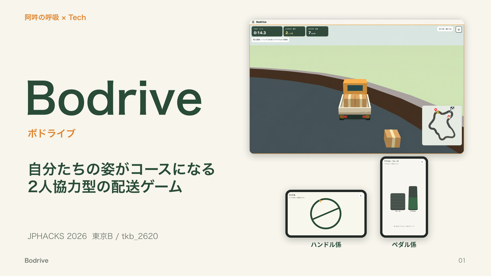

人物写真から体の輪郭を抽出し、自分たちの姿を道路に変えるゲームです。髪・肌・服の色も道路の壁に反映されます。2人がそれぞれスマートフォンの傾きでハンドルとアクセル・ブレーキを担当し、荷物を落とさずにゴールを目指します。

## 概要

### 阿吽の呼吸 × Tech

一枚の写真が、ふたりで遊べる道に変わります。腕の角度、髪の形、服の色。同じ人でもポーズを変えると、違うコースが生まれます。

### 大切にしたいこと：つながりを、現実ごと

私たちが大切にしているのは、人と人のつながりです。そして、つながりはいつも現実の世界の中にあります。並んで写真を撮り、声をかけ合い、時間がたつと少しずつ忘れていく。Bodrive は、つながりそのものだけでなく、つながりがある「現実」も大切にしたいと考えて作りました。

### 課題：一緒にいる時間を、一緒に楽しむ時間に

友達や家族と一緒にいても、会話や協力のきっかけは自然には生まれにくいものです。Bodrive は、この誰もが知っている問題に、新しい解き方で答えます。

### Bodrive の答え

- **話さないと走れない**：ハンドルとペダルを別の人が持ちます。急カーブでは、ペダル係がちょうどいい速さに落とさないと、ハンドルだけでは曲がりきれません。
- **現実と同じルールだから、声が通じる**：トラックはすぐには止まれず、荷物は加速・ブレーキ・旋回の慣性で滑ります。現実の感覚で分かるから、「早めに言って！」「そっと曲がって！」という声かけがそのまま通じます。速く届けたい気持ちと荷物を守りたい気持ちの間で、ふたりで運転を調整します。
- **自分たちの姿が、道になる**：腕を伸ばせば大きなカーブに、曲げた脚は折り返しのある道に。服や髪の色は壁の色になります。「どのポーズにする？」と、写真を選ぶところから会話が始まります。
- **思い出も、現実のように薄れる**：遊ばないコースは忘却曲線に沿って色あせ、31日で消えます。もう一度遊べば、また鮮やかに戻ります。それが「また一緒にやろう」のきっかけになります。

### 遊び方の流れ

#### 1. 写真を選び、人物の輪郭を確認する

携帯などで撮った人物写真を選びます。認識した人物の外周が線で表示されるので、コースにしたい形になっているか確認します。上半身だけでも、一部が見切れていても使えます。写真を使わず、サンプルコースで試すこともできます。

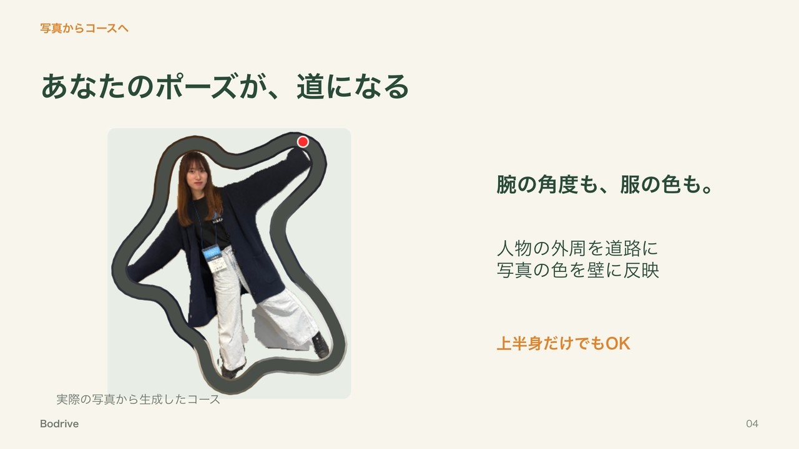

#### 2. 自分だけのコースを作る

人物の輪郭から道路を作り、写真の色を壁に反映します。完成したコースを全体マップで確認し、名前を付けてゲームへ進みます。作成直後のマップには切り抜き写真も表示され、元のポーズと道のつながりを見比べられます。

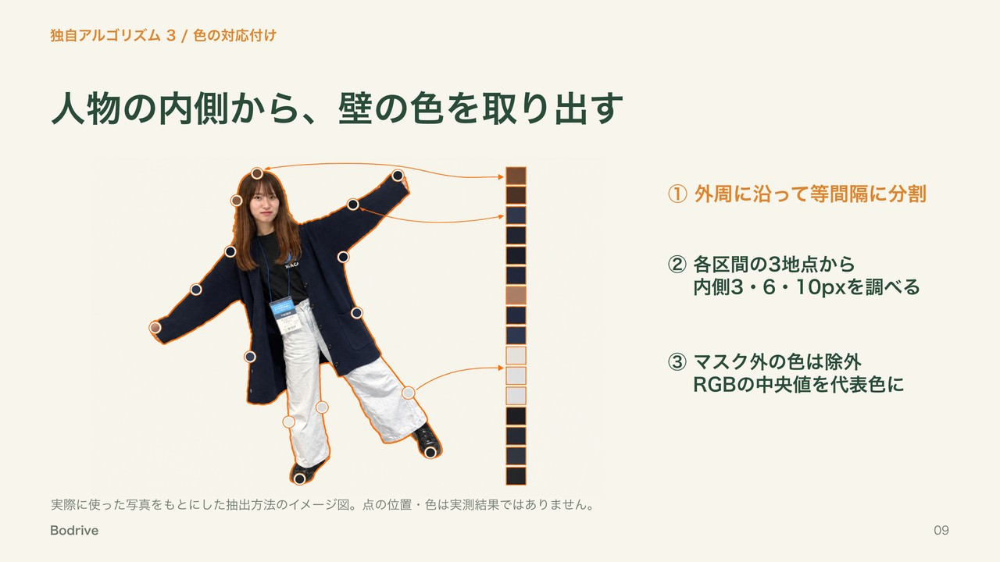

#### 3. スマホをつないで、役割を分ける

PC画面のQRコードを、それぞれのスマホで読み取ります。ハンドル役は端末を横に持って回し、ペダル役は縦に持って前後へ傾けます。

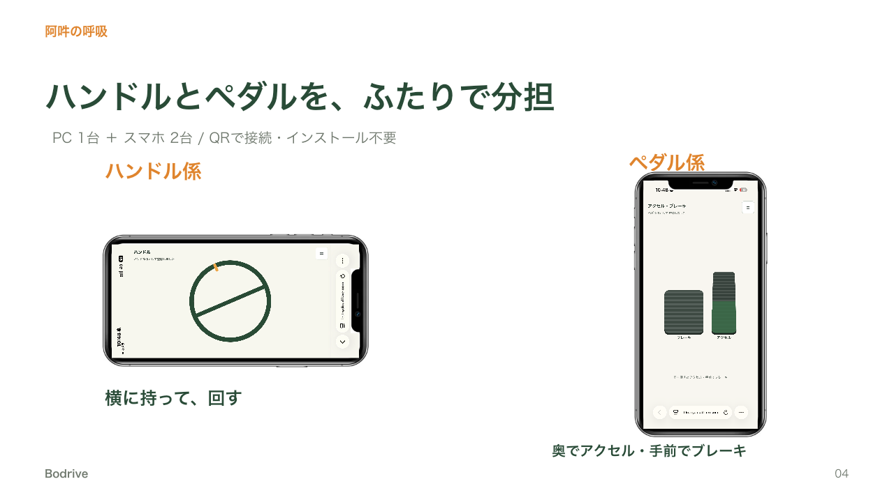

#### 4. 声を掛け合いながら、荷物を届ける

「ここで曲がって！」「ちょっと減速！」と相談しながら、コースの約9割地点にある赤い屋根のお家へ荷物を届けます。急な操作では荷物が滑り、荷台から落ちることも。ミニマップで現在地を確認しながら、速さと丁寧さの両方を意識して走ります。

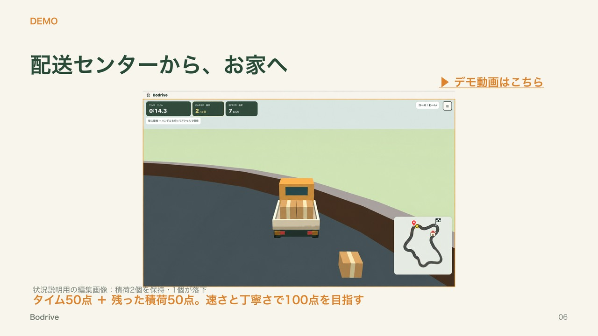

#### 5. 配送伝票で結果を確認する

ゴールすると、タイム・残った積荷・スコアを配送伝票のデザインで表示します。同じルートでもう一度走り、ふたりの連携を試せます。

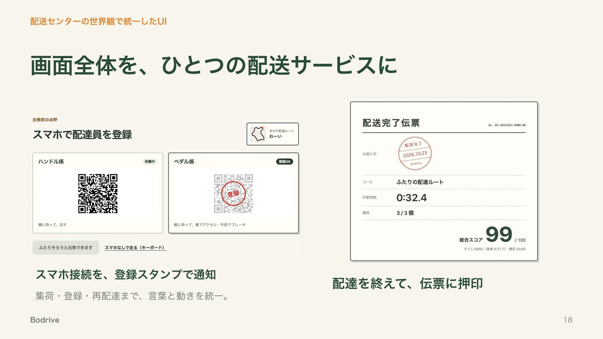

### スコア

総合スコアは100点満点。タイム点50点と、残った積荷に応じた積荷点50点で決まります。

基準タイムはコースの一周の長さから計算します。基準以内ならタイム点は満点で、時間がかかるほど下がります。

### ランキング

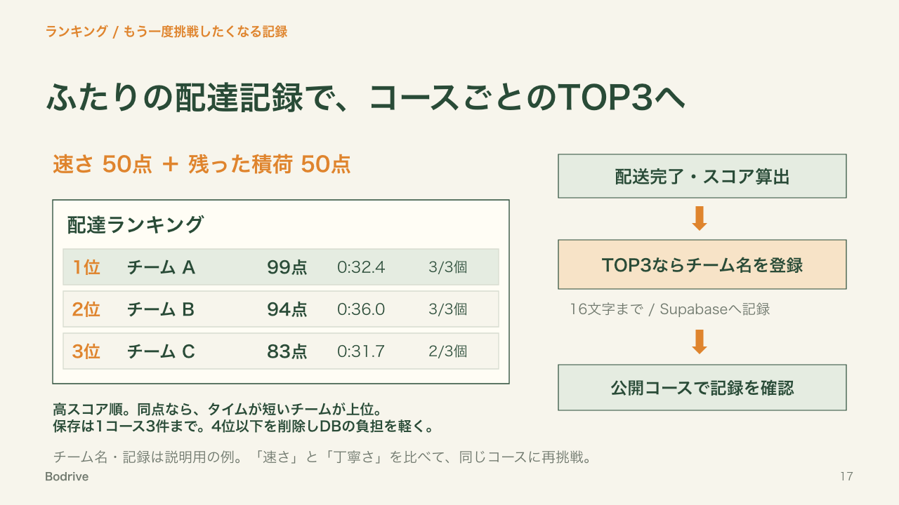

ゴール後、TOP3に入る記録にはチーム名（16文字まで）の登録画面が出ます。ランキングはコースごとに分かれていて、上位3チームだけが残ります。スコアが同じならタイムが短いほう、それも同じなら先に登録したほうが上です。

ホーム画面の「思い出のコース」では、各コースのTOP3（チーム名・スコア・タイム・残った荷物）をそのまま確認できます。写真を使わないサンプルコースにも、専用のランキングがあります。保存する記録を1コースにつき3件に絞り、4位以下を削除することで、DBの保存量と読み出す量を抑えています。

### 思い出のコース

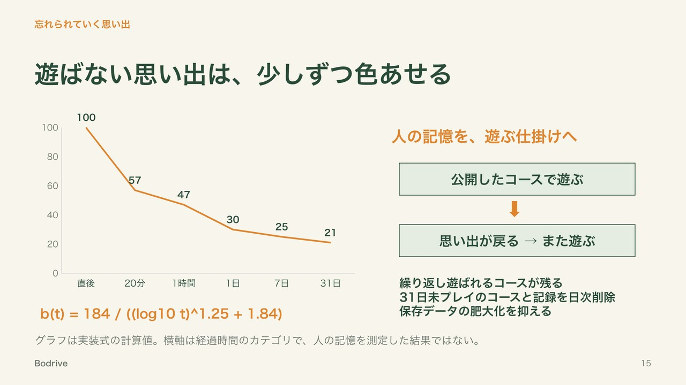

一度遊んだコースは、ホーム画面に並びます。並び順は、エビングハウスの忘却曲線で計算した「思い出度」の高い順です。遊んだ直後は100で、1時間で約47、1日で約30と下がっていき、遊ばれていないコースほどカードが少しずつ色あせます。

31日遊ばれないと（思い出度 約21、エビングハウスの実験の最後の測定点）、そのコースは忘れられたとみなし、ランキングごと消えます。もう一度遊べば思い出度は100に戻ります。サンプルコースは消えません。

人の記憶の変化を着想に、繰り返し遊ばれるコースが残る仕掛けを目指しています。

## 力を入れたこと

### すぐには止まれない運転と、滑る荷物

「現実と同じルールだから、声が通じる」ために、運転と荷物の動きを現実の物理を参考に作りました。

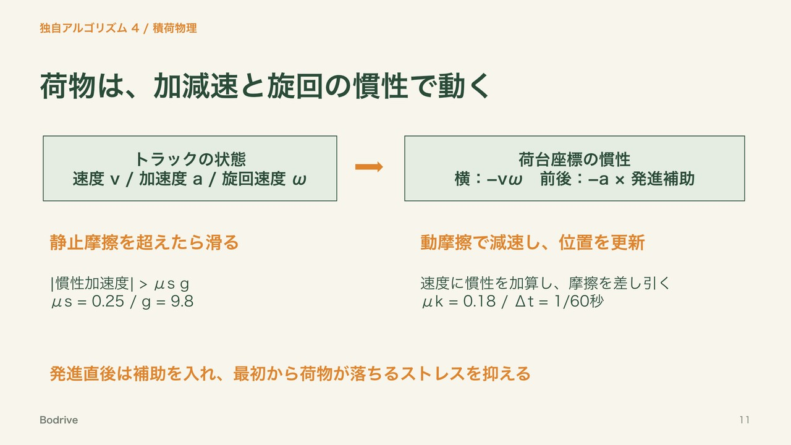

空走距離と制動距離の考え方を参考に、判断して操作する時間と、操作後にブレーキが効いて止まるまでを体験に取り入れました。空走時間を固定で追加せず、ブレーキの効きは約0.4秒で最大まで立ち上がります。現実を参考にしつつ、発進補助など遊びやすさの調整も加えたゲーム用のモデルです。

### 人物らしさを残しながら、走れる道にする

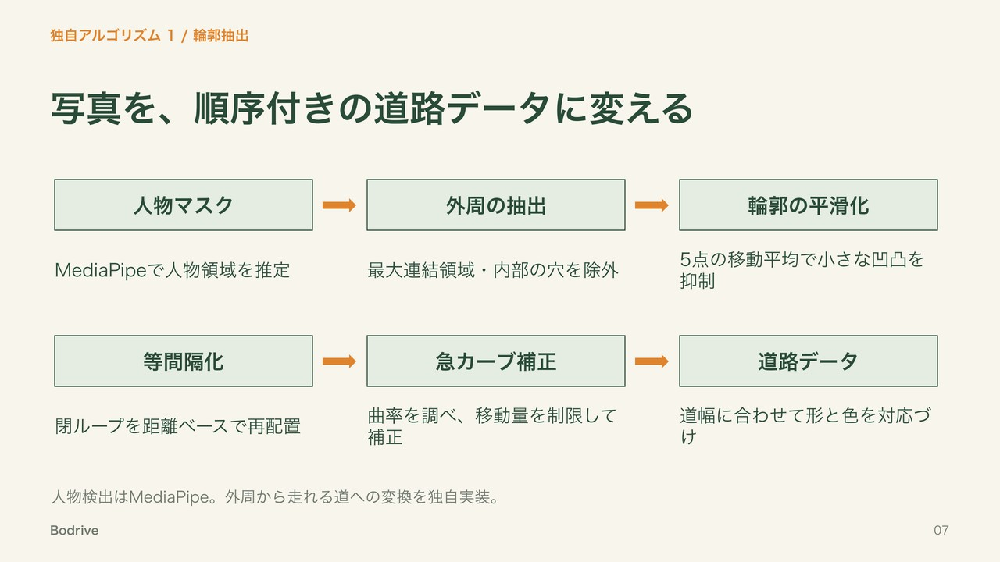

人物マスクから最大の連結領域を選び、内部の穴を含めない外周を取り出します。その後、移動平均で細かな凹凸を減らし、輪郭点を等間隔に並べ直します。急カーブを検出・補正し、道路幅に合わせて形を調整します。

頭・腕・脚などの大きな形を残すため、補正量に上限を設けています。条件を満たせない場合は警告を返し、すべての写真で最小カーブ半径を保証する扱いにはしていません。

### 背景色を拾いにくくする

元の輪郭を距離に沿って16区間に分け、各区間の複数地点で人物の内側を調べます。人物マスクの外側は除き、RGBの中央値から代表色を決めます。取得できない区間は隣の色で補います。

### 写真を保存せず、コースを残す

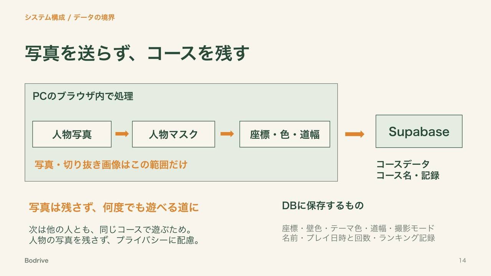

同じコースを後で他の人とも遊べるように、写真から作った道を公開・保存します。人物のプライバシーに配慮し、写真そのものを残すことなく遊びを共有します。

人物の画像処理はブラウザ内で行い、写真自体はサーバーやデータベースへ送信しません。保存するのはコースの座標・色・道幅などです。

切り抜き写真は、作成直後のコース確認と初回プレイのマップに表示します。同じコースを再プレイするときは、写真を表示しません。

### 小さなこだわり

配送の世界観を保ったまま、遊ぶ人が迷わないように細かいところまで作り込みました。

- ホームは配送センターの受付。「新規受付」「再配達」「おためし便」から選ぶ
- ルートを作っている間は、トラックが道を進む絵で進み具合を表示する
- スマホが登録されると、点呼表に「登録」のはんこが押される
- 画面の色は、そのコースのテーマ色（写真の人物の色）に合わせて変わる
- ゴールすると自動で配送完了伝票へ進み、はんこの音とともに結果が出る
- TOP3に入ったときだけ、チーム名の登録画面が出る
- 遊ばれていないコースのカードは、思い出度に合わせて少しずつ色あせる
- スマホがないときも、PCのキーボードで走れる

## 技術スタック

| 用途                         | 技術                                        |
| ---------------------------- | ------------------------------------------- |
| 画面・UI                     | React / TypeScript / Vite                   |
| 3D描画                       | Three.js                                    |
| 人物領域の抽出               | MediaPipe Tasks Vision（Selfie Multiclass） |
| 全身判定の補助               | MediaPipe Pose Landmarker                   |
| PC・スマホ間の通信           | Socket.IO / Node.js                         |
| コース保存・読み込み         | Supabase REST API                           |
| QRコード                     | qrcode.react                                |
| 輪郭処理・色取得・プレビュー | TypeScript / Canvas 2D                      |
| 積荷の動き                   | 独自の簡易物理計算                          |

### システム・処理の流れ

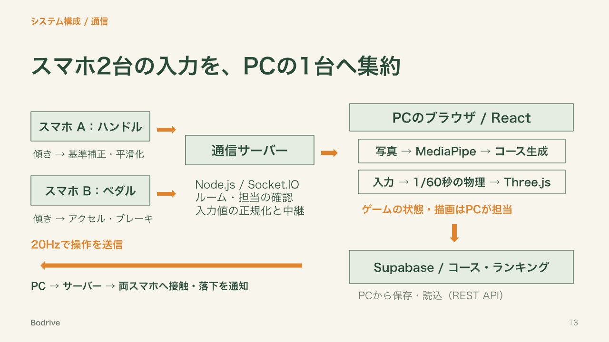

### データベース・ランキングの詳細

データベースはSupabase（PostgreSQL）です。ライブラリは使わず、ブラウザからREST APIを `fetch` で呼びます（[src/db/supabase.ts](src/db/supabase.ts)）。

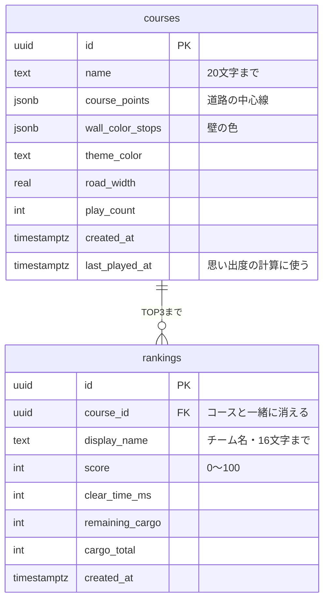

- **写真は保存しない**：コースは座標・壁色・テーマ色・道幅・撮影モード・名前で保存します。別途、プレイ日時・回数やランキングの記録も保存します。
- **思い出度は保存しない**：`last_played_at` から、表示のたびにアプリで計算します（[src/game/memoryScore.ts](src/game/memoryScore.ts)）。
- **ブラウザからできることを絞る**：Row Level Securityと権限で、ブラウザ（Publishable key）からはコースとランキングを読む・新しいコースを保存する・次の2つの関数を呼ぶ、だけにしています。書き換えや削除、ランキングへの直接の書き込みはできません。
  - `record_play(course_id)`：遊び始めにプレイ回数と最終プレイ日時を更新します。
  - `submit_ranking(...)`：記録を入れ、4位以下を消して、順位（圏外ならnull）を返します。同時に登録されても4件以上残らないよう、コースの行をロックしてから処理します。
- **DBを軽く保つ**：`delete_stale_courses(31)` を pg_cron で毎日 03:10（日本時間）に実行し、31日遊ばれていないコースをランキングごと消します。

SQLは [supabase/migrations](supabase/migrations) にあり、ファイル名の順にSupabaseのSQL Editorで実行します。自動削除にはpg_cronの拡張機能を有効にしておく必要があります。データの詳しい仕様は [docs/course-data.md](docs/course-data.md) にまとめています。

## 今後の展望

<!-- 今後の機能・展望はチームで確認して追記。 -->

## ローカルで試す

### 必要なもの

- Node.js **24.16.0**（[.nvmrc](.nvmrc)）とnpm
- PCのブラウザ
- 協力プレイをする場合はスマートフォン2台

### 起動

```sh
npm ci
cp .env.example .env
npm run dev
```

通常はWeb画面が `http://localhost:5173`、通信サーバーが `http://localhost:3001` で起動します。ポートが使用中の場合は、表示されたWebのURLを開いてください。サーバー接続後、写真またはサンプルコースから試せます。

### スマホを接続する

PCとスマホを同じWi-Fiにつなぎ、PC画面のQRコードを読み取ります。スマホの傾き操作にはHTTPS接続が必要です。iPhoneでは操作画面をタップしてセンサーの利用を許可します。

開発中にHTTPSで試す場合は、別のターミナルで以下を実行します。

```sh
# cloudflaredが未導入の場合
brew install cloudflared
# 5173は実際に起動したWebのポートに合わせる
cloudflared tunnel --url http://localhost:5173
```

表示されたHTTPSのURLをPCで開き、その画面のQRコードから参加してください。URLを知っている人がアクセスできるため、利用後はトンネルを終了します。センサーが使えない場合は、スマホ画面のメニュー内のボタンでも操作できます。

ハンドル役は画面を縦向きにロックしたまま、端末の上端が左を向くよう横に持ちます。ペダル役は縦に持ち、上端を奥へ倒すとアクセル、手前へ倒すとブレーキです。持ち方の基準はメニューから調整できます。

### PCだけで操作する

| キー          | 操作         |
| ------------- | ------------ |
| W / ↑         | 加速         |
| S / ↓ / Space | ブレーキ     |
| A・D / ←・→   | 左右へ曲がる |
| R             | STARTに戻す  |

### コース保存を使う場合

[.env.example](.env.example)をコピーした `.env` に、SupabaseのProject URLとPublishable keyを設定します。

```dotenv
VITE_SUPABASE_URL=
VITE_SUPABASE_PUBLISHABLE_KEY=
```

データベースのSQLは [supabase/migrations](supabase/migrations) にあります。未設定でもゲームは遊べますが、コース保存・一覧は使えません。`VITE_` で始まる値はブラウザへ公開されるため、Secret keyやservice_roleキーは設定しないでください。

### 開発用コマンド

```sh
npm run typecheck
npm run lint
npm run format:check
npm run build
```

分けて起動する場合は `npm run dev:web` と `npm run dev:server`。本番用フロントエンドは `dist/` に出力され、通信サーバーは別途 `npm run start:server` で起動します。公開時は `/socket.io` の中継、または接続先とCORSの設定が必要です。設定例は [.env.example](.env.example) を参照してください。

## ソースコードと仕様書

### プログラムの置き場所

| 場所                                                      | 内容                                   |
| --------------------------------------------------------- | -------------------------------------- |
| [src/pages](src/pages) / [src/components](src/components) | 各画面と共通UI                         |
| [src/image-processing](src/image-processing)              | 人物写真からの輪郭・色・コース生成     |
| [src/game](src/game)                                      | 3D道路・トラック・積荷・ゴール・スコア |
| [src/controls](src/controls) / [src/hooks](src/hooks)     | スマホの傾き操作                       |
| [src/socket](src/socket) / [server](server)               | PCとスマホ間の通信                     |
| [src/db](src/db) / [supabase](supabase)                   | 保存データの変換・DB連携               |
| [shared](shared)                                          | コース・通信の共通型                   |

### 詳しい仕様（開発者向け）

処理ごとの細かい仕様・数値・決めた理由は [docs](docs) にまとめています。遊び方を知るだけなら読まなくて大丈夫です。

**写真から道路を作る**

| ページ                                                | 書いてあること                                   |
| ----------------------------------------------------- | ------------------------------------------------ |
| [人物写真の選択](docs/person-capture.md)              | 選べる写真の種類・大きさ、全身判定               |
| [人物の外周抽出](docs/person-contour.md)              | 人物マスクから外周の線を取り出す方法             |
| [輪郭の平滑化](docs/contour-smoothing.md)             | 細かいギザギザを減らす方法と強さ                 |
| [等間隔リサンプリング](docs/contour-resampling.md)    | 輪郭の点を同じ間隔に並べ直す方法                 |
| [急カーブの検出・自動補正](docs/curve-correction.md)  | 曲がりきれないカーブを見つけて緩める方法         |
| [人物カラー抽出](docs/person-colors.md)               | 輪郭の内側から髪・肌・服の色を取る方法           |
| [補正後コースへの色の対応づけ](docs/course-colors.md) | 取った色を道路の壁に塗る方法                     |
| [コース生成中・完成画面](docs/course-screen.md)       | 写真からゲーム用のコースデータを作る流れ・大きさ |
| [写真画面の検証UI整理](docs/capture-ui.md)            | 写真画面に出す確認用の表示                       |
| [コースデータの共通ルール](docs/course-data.md)       | コースの座標・色のルールと、データベースの列     |

**ゲーム**

| ページ                                             | 書いてあること                         |
| -------------------------------------------------- | -------------------------------------- |
| [配送センターからの出発演出](docs/intro-camera.md) | スタート前のカメラの動き               |
| [積荷](docs/cargo.md)                              | 段ボールの置き方・滑り・落下の計算     |
| [壁との接触からの復帰](docs/wall-recovery.md)      | 壁にぶつかったときの戻り方             |
| [お家への配送](docs/delivery-destination.md)       | ゴールのお家の置き場所                 |
| [人型ミニマップ](docs/minimap.md)                  | 現在地を示す小さな地図                 |
| [ゲームHUD](docs/game-hud.md)                      | 走行中に表示する情報                   |
| [音・配送完了演出](docs/game-feedback.md)          | 効果音・音量・ゴールの演出             |
| [エラー時の最低限処理](docs/error-handling.md)     | 失敗したとき・スマホが切れたときの動き |

## チーム

JPHACKS 2026 東京B（tkb_2620）／ チーム名：2PEAS（ツーピース）

ふたりで作業を分け、GitHub のイシューで担当を決めて開発しました。写真からコースを作る処理と、ゲームの中の演出を Yurie が、ゲームの土台・スマホ操作・データベースを Ayaka が中心に担当しています。

| メンバー | 主な担当 |
| --- | --- |
| Yurie Namekawa（[@yurienamekawa](https://github.com/yurienamekawa)） | 写真から道路を作る処理、積荷、ゲーム画面の表示・演出、エラー処理 |
| Ayaka Igarashi（[@igarashiayaka-0127](https://github.com/igarashiayaka-0127)） | ゲームの土台、スマホ2台の操作、データベース・ランキング、デザイン・ゲームバランス |

### 担当の内訳

**Yurie Namekawa**

- 写真から道路を作る：人物写真の選択、外周の抽出、輪郭の平滑化、等間隔化、急カーブ補正
- 色：人物の色の抽出、壁の色の対応づけ
- コース：コース生成中・完成画面
- 積荷：段ボールの配置、滑り（共同）、荷台からの落下
- ゲーム画面：人型ミニマップ、HUD、スタート・ゴールラインの見た目、配送センターからの出発演出、音と配送完了演出、壁にぶつかったあとの復帰
- そのほか：エラー時の処理、写真画面から開発用の表示を取り除く

**Ayaka Igarashi**

- ゲームの土台：コースデータの共通ルール、START地点の決定、3D道路の生成、トラックの走行、ゴール判定
- スマホ操作：PCとスマホ2台の接続、傾きによるハンドル・ペダル操作
- 積荷：滑りの物理（共同）
- 結果・記録：スコア・配送伝票のリザルト画面、コースの保存・読み込み、コース別TOP3ランキング、思い出のコース（思い出度・並び順・古いコースの整理）
- 全体：画面デザインの統一、実機プレイをもとにしたゲームバランスの調整
