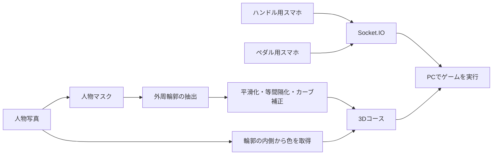
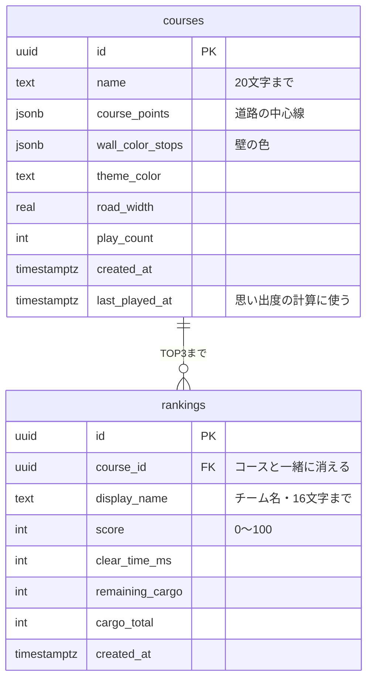

# Bodrive（ボドライブ）

**自分たちの姿がコースになる、2人協力型の配送ゲーム。**

人物写真から体の輪郭を抽出し、自分たちの姿を道路に変えるゲームです。髪・肌・服の色も道路の壁に反映されます。2人がそれぞれスマートフォンの傾きでハンドルとアクセル・ブレーキを担当し、荷物を落とさずにゴールを目指します。写真を撮る楽しさと、息を合わせて運転する楽しさを組み合わせました。

## デモ動画・プレイ画像

<!-- デモ動画・公開URL・プレイ画像をここに追加。人物写真を含む画像は掲載許可を確認してから使用する。 -->

## 概要

### 阿吽の呼吸 × Tech

一枚の写真が、ふたりで遊べる道に変わります。腕の角度、髪の形、服の色。同じ人でもポーズを変えると、違うコースが生まれます。

### 背景・きっかけ

**「そのポーズ、コースにしたら難しそう！」**

一緒に撮った写真を、見るだけで終わらせず、もう一度一緒に遊ぶきっかけにしたい。

Bodriveは、写真に写る人物の輪郭を道路へ変換することで、写真とゲームをつなぎます。操作もひとりで完結させず、ハンドルとペダルをふたりで分担。「もう少しゆっくり！」「ここで曲がって！」という会話が生まれる体験を目指しました。

### 製品概要

携帯などで撮った人物写真を選ぶと、人物の外周から3Dの道路を生成します。髪や肌、服の色は道路の壁に反映されます。全身写真だけでなく、上半身や一部が見切れた写真も使えます。

PCをゲーム画面に、スマートフォン2台をコントローラーにして遊びます。急な加速・ブレーキ・旋回では荷台の段ボールが滑り、落ちることも。速さだけでなく、荷物を大切に運ぶ操作がスコアにつながります。

- **誰と遊ぶか**：友達や家族など、ふたりで役割を分けて遊びます。
- **何を使うか**：PC1台とスマートフォン2台。スマホそのものをハンドルとペダルにします。
- **何が変わるか**：選んだ人物写真のポーズと色によって、コースの形と壁の色が変わります。

### 遊び方の流れ

#### 1. 写真を選び、人物の輪郭を確認する

携帯などで撮った人物写真を選びます。認識した人物の外周が線で表示されるので、コースにしたい形になっているか確認します。上半身だけでも、一部が見切れていても使えます。写真を使わず、サンプルコースで試すこともできます。

<!-- 写真選択・輪郭確認の画面をここに追加。 -->

#### 2. 自分だけのコースを作る

人物の輪郭から道路を作り、写真の色を壁に反映します。完成したコースを全体マップで確認し、名前を付けてゲームへ進みます。作成直後のマップには切り抜き写真も表示され、元のポーズと道のつながりを見比べられます。

<!-- コース完成画面をここに追加。 -->

#### 3. スマホをつないで、役割を分ける

PC画面のQRコードを、それぞれのスマホで読み取ります。ハンドル役は端末を横に持って回し、ペダル役は縦に持って前後へ傾けます。

<!-- ハンドル・ペダルの操作画面をここに追加。 -->

#### 4. 声を掛け合いながら、荷物を届ける

「ここで曲がって！」「ちょっと減速！」と相談しながらコースを一周します。急な操作では荷物が滑り、荷台から落ちることも。ミニマップで現在地を確認しながら、速さと丁寧さの両方を意識して走ります。

<!-- ゲーム画面をここに追加。 -->

#### 5. 配送伝票で結果を確認する

ゴールすると、タイム・残った積荷・スコアを配送伝票のデザインで表示します。同じルートでもう一度走り、ふたりの連携を試せます。

<!-- リザルト画面をここに追加。 -->

### 特長

#### 1. ポーズが変われば、道も変わる

伸ばした腕は大きなカーブに、曲げた脚は折り返しのある道に。用意されたコースを選ぶだけでなく、どんな写真を使うかを考えるところから遊びが始まります。髪や服などの色も壁に反映され、写真ごとの見た目になります。

#### 2. 操作を分けるから、会話が生まれる

曲がりたいタイミングと、減速するタイミングをふたりで合わせる必要があります。スマホを回す・傾けるという身近な動作で操作でき、専用のコントローラーも必要ありません。

#### 3. 速く走るだけでは、高得点にならない

荷台の段ボールは、加速・ブレーキ・旋回に応じて動きます。速く届けたい気持ちと、荷物を守りたい気持ちの間で、ふたりで運転を調整するゲームです。

#### 4. 写真を残さず、遊んだ道を残せる

コースの形や色を保存して、同じ道でまた遊べます。人物写真そのものは保存せず、再プレイ時のマップには輪郭だけを表示します。

### この作品で届けたい体験

写真を選ぶときは「どのポーズにする？」、走るときは「次はもっと上手くいける！」。写真をきっかけに、ふたりで話し、協力し、もう一度挑戦したくなる時間を作ります。

### スコア

総合スコアは100点満点。タイム点50点と、残った積荷に応じた積荷点50点で決まります。

基準タイムはコースの一周の長さから計算します。基準以内ならタイム点は満点で、時間がかかるほど下がります。

### ランキング

ゴール後の配送伝票で、ふたりのチーム名（16文字まで）を入れて登録します。ランキングはコースごとに分かれていて、上位3チームだけが残ります。スコアが同じならタイムが短いほう、それも同じなら先に登録したほうが上です。

ホーム画面の「思い出のコース」では、各コースのTOP3（チーム名・スコア・タイム・残った荷物）をそのまま確認できます。写真を使わないサンプルコースにも、専用のランキングがあります。

### 思い出のコース

一度遊んだコースは、ホーム画面に並びます。並び順は、エビングハウスの忘却曲線で計算した「思い出度」の高い順です。遊んだ直後は100で、1時間で約47、1日で約30と下がっていき、遊ばれていないコースほどカードが少しずつ色あせます。

31日遊ばれないと（思い出度 約21、エビングハウスの実験の最後の測定点）、そのコースは忘れられたとみなし、ランキングごと消えます。もう一度遊べば思い出度は100に戻ります。サンプルコースは消えません。

## 力を入れたこと

### 人物らしさを残しながら、走れる道にする

人物マスクから最大の連結領域を選び、内部の穴を含めない外周を取り出します。その後、移動平均で細かな凹凸を減らし、輪郭点を等間隔に並べ直します。急カーブを検出・補正し、道路幅に合わせて形を調整します。

頭・腕・脚などの大きな形を残すため、補正量に上限を設けています。条件を満たせない場合は警告を返し、すべての写真で最小カーブ半径を保証する扱いにはしていません。

### 背景色を拾いにくくする

元の輪郭を距離に沿って16区間に分け、各区間の複数地点で人物の内側を調べます。人物マスクの外側は除き、RGBの中央値から代表色を決めます。取得できない区間は隣の色で補います。

### 写真を保存せず、コースを残す

人物の画像処理はブラウザ内で行い、写真自体はサーバーやデータベースへ送信しません。保存するのはコースの座標・色・道幅などです。

切り抜き写真は、作成直後のコース確認と初回プレイのマップに表示します。同じコースを再プレイするときは、写真を表示しません。

## 技術スタック

| 用途                         | 技術                                        |
| ---------------------------- | ------------------------------------------- |
| 画面・UI                     | React / TypeScript / Vite                   |
| 3D描画                       | Three.js                                    |
| 人物領域の抽出               | MediaPipe Tasks Vision（Selfie Multiclass） |
| 全身判定の補助               | MediaPipe Pose Landmarker                   |
| PC・スマホ間の通信           | Socket.IO / Node.js                         |
| コース保存・読み込み         | Supabase REST API                           |
| QRコード                     | qrcode.react                                |
| 輪郭処理・色取得・プレビュー | TypeScript / Canvas 2D                      |
| 積荷の動き                   | 独自の簡易物理計算                          |

### システム・処理の流れ



### データベース・ランキングの詳細

データベースはSupabase（PostgreSQL）です。ライブラリは使わず、ブラウザからREST APIを `fetch` で呼びます（[src/db/supabase.ts](src/db/supabase.ts)）。



- **写真は保存しない**：保存するのはコースの座標・色・道幅・名前だけです。
- **思い出度は保存しない**：`last_played_at` から、表示のたびにアプリで計算します（[src/game/memoryScore.ts](src/game/memoryScore.ts)）。
- **ブラウザからできることを絞る**：Row Level Securityと権限で、ブラウザ（Publishable key）からはコースとランキングを読む・新しいコースを保存する・次の2つの関数を呼ぶ、だけにしています。書き換えや削除、ランキングへの直接の書き込みはできません。
  - `record_play(course_id)`：遊び始めにプレイ回数と最終プレイ日時を更新します。
  - `submit_ranking(...)`：記録を入れ、4位以下を消して、順位（圏外ならnull）を返します。同時に登録されても4件以上残らないよう、コースの行をロックしてから処理します。
- **DBを軽く保つ**：`delete_stale_courses(31)` を pg_cron で毎日 03:10（日本時間）に実行し、31日遊ばれていないコースをランキングごと消します。

SQLは [supabase/migrations](supabase/migrations) にあり、ファイル名の順にSupabaseのSQL Editorで実行します。自動削除にはpg_cronの拡張機能を有効にしておく必要があります。データの詳しい仕様は [docs/course-data.md](docs/course-data.md) にまとめています。

## 今後の展望

<!-- 今後の機能・展望はチームで確認して追記。 -->

## ローカルで試す

### 必要なもの

- Node.js **24.16.0**（[.nvmrc](.nvmrc)）とnpm
- PCのブラウザ
- 協力プレイをする場合はスマートフォン2台

### 起動

```sh
npm ci
cp .env.example .env
npm run dev
```

通常はWeb画面が `http://localhost:5173`、通信サーバーが `http://localhost:3001` で起動します。ポートが使用中の場合は、表示されたWebのURLを開いてください。サーバー接続後、写真またはサンプルコースから試せます。

### スマホを接続する

PCとスマホを同じWi-Fiにつなぎ、PC画面のQRコードを読み取ります。スマホの傾き操作にはHTTPS接続が必要です。iPhoneでは操作画面をタップしてセンサーの利用を許可します。

開発中にHTTPSで試す場合は、別のターミナルで以下を実行します。

```sh
# cloudflaredが未導入の場合
brew install cloudflared
# 5173は実際に起動したWebのポートに合わせる
cloudflared tunnel --url http://localhost:5173
```

表示されたHTTPSのURLをPCで開き、その画面のQRコードから参加してください。URLを知っている人がアクセスできるため、利用後はトンネルを終了します。センサーが使えない場合は、スマホ画面のメニュー内のボタンでも操作できます。

ハンドル役は画面を縦向きにロックしたまま、端末の上端が左を向くよう横に持ちます。ペダル役は縦に持ち、上端を奥へ倒すとアクセル、手前へ倒すとブレーキです。持ち方の基準はメニューから調整できます。

### PCだけで操作する

| キー          | 操作         |
| ------------- | ------------ |
| W / ↑         | 加速         |
| S / ↓ / Space | ブレーキ     |
| A・D / ←・→   | 左右へ曲がる |
| R             | STARTに戻す  |

### コース保存を使う場合

[.env.example](.env.example)をコピーした `.env` に、SupabaseのProject URLとPublishable keyを設定します。

```dotenv
VITE_SUPABASE_URL=
VITE_SUPABASE_PUBLISHABLE_KEY=
```

データベースのSQLは [supabase/migrations](supabase/migrations) にあります。未設定でもゲームは遊べますが、コース保存・一覧は使えません。`VITE_` で始まる値はブラウザへ公開されるため、Secret keyやservice_roleキーは設定しないでください。

### 開発用コマンド

```sh
npm run typecheck
npm run lint
npm run format:check
npm run build
```

分けて起動する場合は `npm run dev:web` と `npm run dev:server`。本番用フロントエンドは `dist/` に出力され、通信サーバーは別途 `npm run start:server` で起動します。公開時は `/socket.io` の中継、または接続先とCORSの設定が必要です。設定例は [.env.example](.env.example) を参照してください。

## ソース・仕様書

| 場所                                                      | 内容                                   |
| --------------------------------------------------------- | -------------------------------------- |
| [src/pages](src/pages) / [src/components](src/components) | 各画面と共通UI                         |
| [src/image-processing](src/image-processing)              | 人物写真からの輪郭・色・コース生成     |
| [src/game](src/game)                                      | 3D道路・トラック・積荷・ゴール・スコア |
| [src/controls](src/controls) / [src/hooks](src/hooks)     | スマホの傾き操作                       |
| [src/socket](src/socket) / [server](server)               | PCとスマホ間の通信                     |
| [src/db](src/db) / [supabase](supabase)                   | 保存データの変換・DB連携               |
| [shared](shared)                                          | コース・通信の共通型                   |

- 写真・輪郭：[写真の選択](docs/person-capture.md)、[外周抽出](docs/person-contour.md)、[平滑化](docs/contour-smoothing.md)、[等間隔化](docs/contour-resampling.md)、[急カーブ補正](docs/curve-correction.md)
- 色・コース：[人物カラー](docs/person-colors.md)、[壁の色](docs/course-colors.md)、[共通データ仕様](docs/course-data.md)
- ゲーム：[積荷](docs/cargo.md)、[ミニマップ](docs/minimap.md)、[HUD](docs/game-hud.md)、[エラー処理](docs/error-handling.md)
- 編集用：[READMEの追記メモ・参考資料](docs/readme-editing.md)、[過去の開発メモ](docs/development-history.md)

## チーム

<!-- チーム名・メンバー・担当・リンクを確認して追記。 -->
